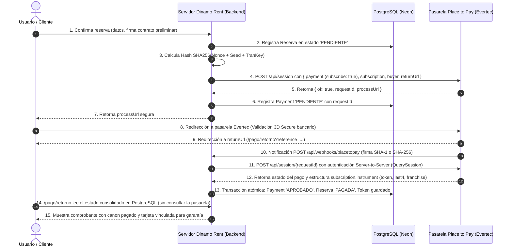
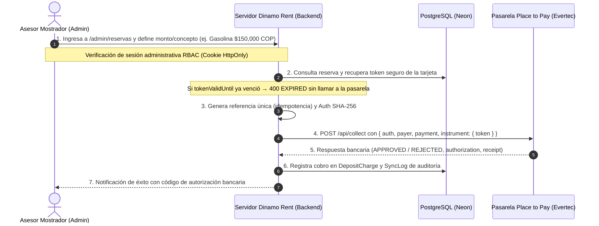

# Documento de Homologación Técnica y de Seguridad

## Integración Pasarela de Pagos Place to Pay (Evertec)

### Modelo: Hosted Checkout + Suscripción (Tokenización) + Collect

### Dinamo Rent a Car Cartagena de Indias

---

**Empresa:** Dinamo Rent a Car S.A.S. — NIT 900694866-3  
**Ubicación:** Cartagena de Indias, Bolívar, Colombia  
**Proyecto:** Plataforma Web Transaccional y Reservas en Línea (`dinamo_rent_web`)  
**Proveedor Pasarela:** Place to Pay (Evertec Colombia)  
**Tipo de Integración:** Checkout Redirección Seguro (Hosted Payment Page) con Tokenización de Tarjetas (`subscription`) y Cobros Posteriores Server-to-Server (`/api/collect`)  
**Nivel de Cumplimiento PCI-DSS:** SAQ A (Servidores de Dinamo Rent 100% exentos de datos de tarjetahabientes)  
**Fecha de Elaboración:** Septiembre 2026  
**Última actualización:** 23 de noviembre de 2026 (IVA 19%, solo tarjetas internacionales, cuenta de recaudo)  
**Versión del Documento:** 1.3.0 (Webhook SHA-256, idempotencia y configuración fail-closed)

---

## 1. Resumen Ejecutivo y Justificación del Modelo

**Dinamo Rent a Car** es una empresa dedicada al alquiler de vehículos turísticos y corporativos con base de operaciones en Cartagena de Indias (oficina principal en Crespo).

En el modelo de negocio de alquiler de vehículos en Colombia, el servicio de **Preautorización (Hold / Retención temporal de cupo)** no se encuentra actualmente habilitado por las entidades adquirentes bancarias. En respuesta y siguiendo las directrices técnicas de **Evertec / Place to Pay**, se ha implementado el modelo oficial y certificado de **Suscripción (Tokenización de Tarjetas)** en combinación con el servicio Server-to-Server **`/api/collect`**.

### Este modelo resuelve dos necesidades operativas críticas

1. **Cobro del Canon de Alquiler:** El cliente paga el valor correspondiente a los días de alquiler, seguros y accesorios seleccionados **más el IVA del 19%** mediante la pasarela segura. Las tarifas publicadas no incluyen IVA: el impuesto se calcula y se suma en el servidor al crear la reserva.
2. **Depósito de Garantía sin Fricción:** En la misma sesión de checkout, el cliente autoriza la suscripción (tokenización) de su tarjeta de crédito/débito. Esto permite a Dinamo Rent respaldar la garantía del vehículo sin congelar cupo bancario anticipadamente al usuario, manteniendo la capacidad de procesar cobros justificados posteriores (deducibles de siniestros, combustible faltante, días adicionales de retraso o multas de tránsito) mediante llamadas seguras Server-to-Server.

---

## 2. Topología de Arquitectura y Tecnologías

El sistema implementa una arquitectura moderna, desacoplada y con defensas criptográficas multicapa:

```text
[ Cliente / Navegador Web ]
           │
           │  HTTPS / TLS 1.3
           ▼
[ Frontend + Backend: SvelteKit 2 (Node.js) ]
  • Validación estricta de contratos y firmas digitales
  • Generación de firmas criptográficas CSPRNG (Nonce + Seed + SHA-256)
  • Orquestación de sesiones de pago y tokenización
           │
           ├──────────────────────────────┬──────────────────────────────┐
           │ HTTPS (API REST Evertec)     │ TLS 1.3 (Pooler Seguro)      │ API Token Auth
           ▼                              ▼                              ▼
[ Pasarela Place to Pay (Evertec) ]  [ Base de Datos Neon PG ]   [ Sync Mostrador ]
• Procesamiento bancario 3DS          • PostgreSQL Serverless    • Software Local
• Ambiente certificado PCI-DSS Nivel 1 • Tokens y auditoría       • Mostrador Oficina Crespo
• Bóveda de tarjetas (Tokenización)   • Registros inmutables
```

### Componentes Técnicos

* **Framework Web & API Gateway:** SvelteKit 2 + TypeScript + Vite.
* **Entorno de Ejecución:** Node.js en ambiente seguro con cifrado TLS 1.3 forzado.
* **Base de Datos Principal:** PostgreSQL alojada en Neon Serverless (`sslmode=require`, cifrado en reposo y en tránsito).
* **ORM:** Prisma con tipado estricto y soporte transaccional atómico (`$transaction`).
* **Seguridad Criptográfica:** Módulo nativo `node:crypto` de Node.js (algoritmo CSPRNG de 16 bytes y SHA-256).

---

## 3. Modelo de Integración: Hosted Checkout con Suscripción

Dinamo Rent a Car implementa el modelo **Hosted Checkout (Redirección)** con estructura combinada de `payment` + `subscription`.

### Ventajas de Seguridad

1. **Cumplimiento Estricto PCI-DSS SAQ A:** El cliente digita los 16 dígitos de su tarjeta (PAN), fecha de expiración y código CVV **exclusivamente dentro de los servidores seguros de Evertec**, amparados por su certificación PCI-DSS Nivel 1.
2. **Cero Exposición de Datos Financieros:** Dinamo Rent **nunca recibe, nunca procesa, nunca transmite y nunca almacena números de tarjeta ni códigos CVV**.
3. **Manejo de Tokens Criptográficos Opacos:** Evertec devuelve un `token` alfanumérico que únicamente tiene validez dentro de la plataforma de Evertec para el comercio autorizado.

---

## 4. Flujo Transaccional Paso a Paso

El ciclo de vida del alquiler y el respaldo de garantía se divide en dos fases operativas:

### 4.1 Fase 1: Reserva, Pago del Canon y Tokenización de Garantía (Checkout)



### 4.2 Fase 2: Ejecución de Cobros de Garantía / Incidentes (`/api/collect`)

Si al devolver el vehículo no hay novedades ni daños, **no se realiza ningún cargo adicional**.

En caso de requerirse cobro por deducible, combustible o días extra:



---

## 5. Especificación de Endpoints y Payloads de Evertec

### 5.1 Estructura del Objeto de Autenticación Dinámica (`auth`)

Cada llamada saliente a las API de Place to Pay genera una cabecera criptográfica fresca:

```json
{
  "login": "P2P_LOGIN_ASIGNADO",
  "tranKey": "BASE64_SHA256(rawNonce + seed + secretKey)",
  "nonce": "NONCE_BASE64_16_BYTES_CSPRNG",
  "seed": "2026-09-21T18:00:00.000Z"
}
```

* **Mitigación de Replay Attacks:** Cada petición utiliza un `nonce` aleatorio de 16 bytes emitido por `crypto.randomBytes(16)` y un `seed` ISO 8601 que expira en minutos según la tolerancia de Evertec. La llave secreta `secretKey` jamás se transmite en texto claro.

### 5.2 Creación de Sesión con Suscripción (`POST /api/session`)

```json
{
  "auth": { ... },
  "locale": "es_CO",
  "buyer": {
    "name": "Juan",
    "surname": "Pérez",
    "email": "juan.perez@email.com",
    "mobile": "3001234567",
    "documentType": "CC",
    "document": "1047123456"
  },
  "payment": {
    "reference": "DIN-189201-4412",
    "description": "Alquiler Dinamo Rent - Renault Duster Iconic (4 dias)",
    "amount": {
      "currency": "COP",
      "total": 809200,
      "taxes": [
        { "kind": "valueAddedTax", "base": 680000, "amount": 129200 }
      ]
    },
    "subscribe": true
  },
  "expiration": "2026-09-21T19:00:00.000Z",
  "returnUrl": "https://dinamorent.com/pago/retorno",
  "ipAddress": "190.131.x.x",
  "userAgent": "Mozilla/5.0 DinamoRent/1.0"
}
```

> La sesión se crea con `payment.subscribe: true` y **sin** el bloque raíz `subscription`: PlacetoPay rechaza la combinación de pago y suscripción en la misma petición ("No se puede realizar un pago y una subscripción al mismo tiempo"). El bloque `subscription` de la respuesta sí se consume para extraer el token.

### 5.3 Extracción del Token en la Consulta de Sesión (`POST /api/session/{requestId}`)

Evertec entrega en la respuesta la confirmación del canon y los datos del instrumento tokenizado:

```json
{
  "status": {
    "status": "APPROVED",
    "reason": "00",
    "message": "La petición ha sido aprobada exitosamente",
    "date": "2026-09-21T18:05:00.000Z"
  },
  "payment": [
    {
      "status": { "status": "APPROVED" },
      "reference": "DIN-189201-4412",
      "amount": { "currency": "COP", "total": 809200 },
      "authorization": "AUTH-789412",
      "franchise": "VISA",
      "lastDigits": "4242"
    }
  ],
  "subscription": {
    "status": { "status": "APPROVED" },
    "instrument": [
      { "keyword": "token", "value": "e07ca9986cf0ecac8a557fa11c07bf37ea35e9e3e3a4180c49" },
      { "keyword": "last_digits", "value": "4242" },
      { "keyword": "franchise", "value": "visa" },
      { "keyword": "valid_until", "value": "2029-12-31" }
    ]
  }
}
```

### 5.4 Cobro Posterior Server-to-Server (`POST /api/collect`)

```json
{
  "auth": { ... },
  "payer": {
    "name": "Juan",
    "surname": "Pérez",
    "email": "juan.perez@email.com",
    "documentType": "CC",
    "document": "1047123456",
    "mobile": "+573001234567"
  },
  "payment": {
    "reference": "COL-DIN-189201-GAS-01",
    "description": "Dinamo Rent: GASOLINA - Combustible faltante (Reserva DIN-189201-4412)",
    "amount": {
      "currency": "COP",
      "total": 120000
    }
  },
  "instrument": {
    "token": {
      "token": "e07ca9986cf0ecac8a557fa11c07bf37ea35e9e3e3a4180c49"
    }
  },
  "ipAddress": "190.131.x.x",
  "userAgent": "DinamoRentAdmin/1.0 Server-Collect"
}
```

**Normalización de `description`.** La API de PlacetoPay valida `payment.description` con un conjunto restringido de caracteres y una longitud máxima. Por eso el texto se construye en el servidor y se sanea antes de enviarlo: `sanitizeGatewayText()` (`src/lib/server/placetopay.ts`) pasa el valor a ASCII imprimible, reemplaza guiones tipográficos (`—`, `–`), elimina saltos de línea y caracteres no garantizados (`#`, `%`, `&`, `@`, `[]`, comillas tipográficas), colapsa espacios y lo acota a **200 caracteres**. El formato final es:

```text
Dinamo Rent: {CONCEPTO} - {detalle del administrador} (Reserva {CODIGO})
```

La versión saneada es la única que existe: es la que viaja a la pasarela y la que se persiste en `deposit_charges.description` para auditoría del cargo. El texto libre original con tildes, guiones tipográficos o caracteres no garantizados **no** se almacena en ningún campo (evita duplicar datos y conservar valores que la pasarela nunca recibió). Para reconstruir lo ocurrido basta el propio registro: concepto, detalle saneado, monto, estado, `p2pRequestId` y mensaje de la pasarela. Esto corrige el error de validación reportado por Evertec al probar los distintos conceptos de cargo.

**Respuestas del cobro.** `APPROVED` → **200**. Rechazo del emisor (`REJECTED`) → **402** con `attempts` y `tokenInvalidation`. Sin veredicto de la pasarela (timeout, error de red o credenciales ausentes) → **502** con `status: "PENDING"`, el cargo queda `PENDIENTE` y el token **no** se toca: esos fallos no cuentan como intentos para la invalidación automática, para no desvincular la tarjeta del cliente por una caída propia.

**Token vencido: rechazo local sin llamar a la pasarela.** Antes de generar la referencia de cobro y de invocar `/api/collect`, el servidor compara `payments.tokenValidUntil` con la hora actual (`isTokenExpired`, en `src/lib/utils/tokenValidity.ts`). Un valor `YYYY-MM-DD` vale hasta el final de ese día en UTC; una hora sin zona se interpreta como UTC; un valor ausente o ilegible **no** se considera vencido (en ese caso decide la pasarela). Si el token venció, el cobro no viaja a Evertec: se marca `tokenStatus = "EXPIRADO"`, se registra un `SyncLog` con `payload.purpose = "EXPIRACION"` y `gatewayCalled: false`, **no** se crea `DepositCharge`, no se consume ningún intento de la regla de 3 y no se ejecuta `classifyTokenRejection` (que invalidaría el token de inmediato por un rechazo de tarjeta vencida). Respuesta —HTTP **400**—:

```json
{
  "ok": false,
  "status": "EXPIRED",
  "tokenStatus": "EXPIRADO",
  "retokenizationRequired": true,
  "error": "El token de la tarjeta venció el 2020-01-31 y quedó marcado como EXPIRADO. Registra una nueva tarjeta de garantía (re-tokenización) antes de cobrar. No se envió ningún cargo a la pasarela."
}
```

El mensaje cita la fecha informada por la pasarela y la acción concreta (re-tokenizar). El panel `/admin/reservas` aplica el mismo criterio en el cliente: muestra el token como **EXPIRADA** con la fecha de vigencia, oculta el botón de cobro y deja a la vista la re-tokenización. La sonda diaria (`GET /api/cron/p2p-check-pending`) marca `EXPIRADO` todo token vencido con su propio `SyncLog`, de modo que el estado no depende de que alguien intente cobrar.

**Error de validación ≠ rechazo de tarjeta.** Si la pasarela responde un HTTP distinto de 2xx, o un `REJECTED` cuyo mensaje corresponde a un campo/formato de la solicitud (por ejemplo `El campo description es inválido`), el resultado se clasifica como `PENDING`: no consume intentos y **no** dispara la invalidación del token. Solo un rechazo real del emisor (`Fondos insuficientes`, `Tarjeta vencida`, etc.) alimenta la regla de 3 intentos o la invalidación inmediata.

### 5.4.1 Actualización administrativa del medio de pago (tokenización sin cobro)

Requisito de certificación: registrar o reemplazar la tarjeta de garantía sin depender de un pago aprobado, para poder reproducir de forma controlada los escenarios de rechazo recuperable y no recuperable.

**Ruta del panel:** `/admin/reservas` → botón de escudo de la reserva → **«Registrar tarjeta de garantía»** o **«Actualizar medio de pago»**. El administrador es redirigido al Hosted Checkout de PlacetoPay, registra la tarjeta y vuelve al panel; el token se guarda en `payments` y queda `ACTIVO`.

**Creación de la sesión (servidor, autenticado):** `POST /api/payments/token/resubscribe` con `{ reservationId }`. Envía el bloque raíz `subscription` y **ningún** objeto `payment`, tal como documenta PlacetoPay en «Crear Sesión»:

```json
{
  "auth": { ... },
  "locale": "es_CO",
  "buyer": {
    "name": "Juan",
    "surname": "Perez",
    "email": "juan.perez@email.com",
    "mobile": "3001234567",
    "documentType": "CC",
    "document": "1047123456"
  },
  "subscription": {
    "reference": "DIN-189201-4412",
    "description": "Tokenizacion tarjeta de garantia - Reserva DIN-189201-4412"
  },
  "expiration": "2026-09-21T19:00:00.000Z",
  "returnUrl": "https://dinamo-rent-a-car.vercel.app/api/payments/token/resubscribe/return?reservationId=...",
  "ipAddress": "190.131.x.x",
  "userAgent": "Mozilla/5.0 DinamoRent/1.0 Admin-Tokenization"
}
```

* **Retorno:** `GET /api/payments/token/resubscribe/return` consulta la sesión (`QuerySession`), reintenta si la pasarela aún no consolidó el instrumento y guarda `token`, `tokenStatus = ACTIVO`, `tokenValidUntil`, `tokenFranchise`, franquicia y últimos 4 en `payments`. **No** modifica el estado del pago original ni el de la reserva.
* **Webhook:** si la notificación corresponde a una sesión de tokenización pura (`subscription` sin arreglo `payment`), `queryPaymentSession` devuelve `subscriptionOnly: true` y el webhook solo actualiza el instrumento. Nunca marca la reserva como `PAGADA`.
* **Ciclo completo certificable:** tokenizar sin cobro → ejecutar Collect con el token → provocar rechazo recuperable (hasta 3 intentos) → provocar rechazo no recuperable (invalidación inmediata) → confirmar que el token invalidado no permite nuevos cobros.

### 5.5 Impuestos (IVA 19%) y consistencia del monto

Las tarifas publicadas **no incluyen IVA**. El impuesto se calcula en el servidor al crear la reserva:

* `subtotal` = vehículo + seguro + adicionales.
* `iva` = `Math.round(subtotal × 0,19)`.
* `total` = `subtotal + iva`; es lo que se guarda en `Reservation.totalAmount` y lo que se cobra.
* En la sesión se envía `payment.amount.total` con IVA y `payment.amount.taxes: [{ kind: "valueAddedTax", base: subtotal, amount: iva }]`. El `kind` debe ser exactamente `valueAddedTax`: otro valor hace que PlacetoPay ignore el impuesto.
* El desglose visible (modal de reserva, comprobante `/pago/retorno` y panel `/admin/reservas`) se calcula desde los importes guardados, de modo que el valor que ve el cliente, el persistido y el enviado a la pasarela son el mismo.
* Las reservas anteriores a este cambio (donde `total = subtotal`) no envían el bloque `taxes`: no se declara un impuesto en cero.

**Medios de pago:** solo tarjetas de crédito y débito de bancos internacionales (Visa, Mastercard, American Express). PSE, Nequi y transferencias bancarias **no** están habilitados.

### 5.6 Notificación asíncrona (webhook): firma e idempotencia

**Endpoint:** `POST /api/webhooks/placetopay`. La URL se registra en el panel de Evertec; no se envía dentro del payload de la sesión.

**Validación de firma.** Se aceptan los dos formatos documentados por PlacetoPay:

* **SHA-1 (heredado):** 40 caracteres hex, sin prefijo → `SHA1(requestId + status.status + status.date + tranKey)`.
* **SHA-256 (recomendado):** 64 caracteres hex con prefijo `sha256:` → `SHA256(misma cadena)`.

La cadena se arma siempre con `P2P_TRAN_KEY`; el prefijo determina el algoritmo. Antes de comparar se valida que el valor sea hexadecimal (evita que `Buffer.from(..., 'hex')` descarte caracteres en silencio) y se comprueba la longitud. La comparación usa `crypto.timingSafeEqual`. Una firma ausente, mal formada o calculada con otro secreto devuelve **401** sin escribir en la base de datos.

**Fuente del estado.** La notificación nunca define el estado final: el servidor ejecuta `QuerySession` (`POST /api/session/{requestId}`) y solo aplica lo confirmado por la pasarela. Si no se puede confirmar, responde **502** para que Evertec reintente.

**Idempotencia.** La firma de una notificación sigue siendo válida de forma indefinida, por lo que el webhook es idempotente:

* Pago ya `APROBADO` → responde 200 con `duplicate: true` y no reescribe pago ni reserva.
* Notificación de tokenización sin cobro (`subscriptionOnly`) → solo actualiza el token del instrumento y responde 200 con `tokenUpdated: true`; el pago y la reserva no cambian de estado.
* Reserva `CANCELADA` + notificación `APPROVED` → no se revive la reserva; se registra un `SyncLog` con `ignored: RESERVA_CANCELADA` y se responde 200 para detener los reintentos.

**Configuración fail-closed.** Con `P2P_ENV=prod`, si falta `P2P_LOGIN` o `P2P_TRAN_KEY`, ninguna función de `src/lib/server/placetopay.ts` llama a la pasarela: creación de sesión, consulta, `collect` e invalidación devuelven error explícito. No hay credenciales de sandbox por defecto en producción.

**Cobertura de pruebas:** `tests/webhook.placetopay.test.ts` (firma SHA-1, SHA-256 válida, SHA-256 con otro secreto, firma manipulada, duplicado y reserva cancelada) y `tests/placetopay.production.test.ts` (fail-closed sin credenciales y sin llamadas a `fetch`).

---

## 6. Cumplimiento de Normativa PCI-DSS

### 6.1 Criterio SAQ A (Self-Assessment Questionnaire A)

* Dinamo Rent a Car externaliza el 100% de la captura de instrumentos financieros hacia Place to Pay (Evertec).
* **PAN (Primary Account Number de 16 dígitos):** NO se almacena, NO se procesa ni viaja por nuestros servidores.
* **CVV / CVC:** NO se almacena ni se procesa.
* **PIN Bancario:** NO se almacena ni se procesa.
* **Datos Almacenados Únicamente con Fines de Facturación y Auditoría:**
  * `token`: Cadena aleatoria no reversible emitida por Evertec.
  * `cardBrand`: Franquicia (ej. `VISA`, `MASTERCARD`).
  * `cardLast4`: Enmascaramiento oficial de auditoría (ej. `4242`).
  * `authorization`: Código de autorización emitido por la red bancaria.
  * `transactionId` y `requestId`: Identificadores únicos de sesión de Evertec.

---

## 7. Políticas de Seguridad y Prevención de Fraude

1. **Protección contra Cobros Duplicados (Idempotencia):**
   * Evertec valida que no existan cobros idénticos en menos de 24 horas sobre la misma referencia y monto.
   * Dinamo Rent genera referencias estructuradas únicas: `COL-{reservationCode}-{timestamp}`.
2. **Control de Acceso Administrativo (RBAC):**
   * El endpoint `/api/payments/collect` está protegido con verificación criptográfica HMAC-SHA256 de sesión administrativa con cookies `HttpOnly`, `SameSite=Lax` y `Secure`.
3. **Trazabilidad y Consentimiento:**
   * En el paso 3 de la reserva, el cliente firma digitalmente aceptando el débito de deducibles o gasolina justificados.
   * En el paso 4 se informa con total claridad que la tarjeta queda vinculada como respaldo sin congelamiento previo de cupo.
   * Cada cargo ejecutado se registra de forma inmutable en la tabla `deposit_charges` con el usuario administrativo que autorizó la operación.

---

## 8. Guía de Preguntas Frecuentes para el Comité de Seguridad de Evertec

| Pregunta de Evertec | Respuesta Técnica de Dinamo Rent a Car |
| :--- | :--- |
| **¿Por qué utilizan el modelo de Suscripción en lugar de Preautorización?** | Debido a que la preautorización no se encuentra habilitada para el comercio adquirente en Colombia, Evertec recomendó el uso de Suscripción (Tokenización) para garantizar el respaldo del depósito de garantía del vehículo y procesar cobros de contingencias mediante `/api/collect`. |
| **¿En algún momento Dinamo Rent manipula datos de tarjeta sin tokenizar?** | No. Tanto el pago del canon como la suscripción inicial ocurren 100% dentro del Hosted Checkout de Evertec bajo protocolo 3D Secure. Nuestro servidor solo recibe el `token` resultante. |
| **¿Cómo garantizan que un cobro posterior con token esté justificado?** | La reserva cuenta con firma digital del contrato preliminar y aceptación de términos. Además, el endpoint `/api/payments/collect` requiere autenticación administrativa estricta y genera registros de auditoría en PostgreSQL con el concepto (deducible, gasolina, mora). |
| **¿Cómo manejan la idempotencia en `/api/collect`?** | Cada llamada a `/api/collect` genera un código de referencia irrepetible (`COL-{codigoReserva}-{timestamp}`), aprovechando la ventana de protección de 24 horas de Evertec. |
| **¿Qué ambientes tienen configurados?** | Disponemos de ambientes parametrizados mediante `P2P_ENV`: `test` apunta a `checkout-test.placetopay.com` y `prod` a `checkout.placetopay.com`. Pasar a producción requiere únicamente el cambio de variables de entorno seguras. |

---

## 9. Contactos del Equipo de Desarrollo

* **Líder de Proyecto & Arquitectura Técnica:** Equipo de Tecnología Dinamo Rent a Car
* **Correo de Contacto Técnico:** `tecnologia@dinamorent.com` / `reservas@dinamorent.com`
* **Cartagena de Indias, Colombia**
